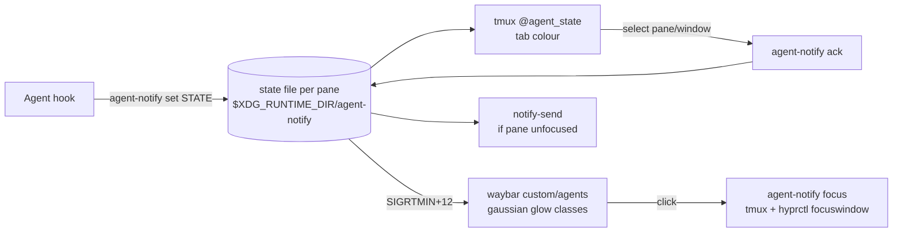

# agent-notify

Shows which coding agents (one per tmux pane) are working, finished, or need you,
on the tmux tabs and as a glow in waybar. Agent-agnostic: any agent can call
`agent-notify set <state>` from its hooks.

## States

| State     | Meaning                         | Waybar / tab          | Fades |
|-----------|---------------------------------|-----------------------|-------|
| `working` | agent is busy                   | `⟳` count, no glow    | n/a   |
| `idle`    | finished, you have not looked   | amber glow            | 180s  |
| `asking`  | agent asked you a question      | blue glow, `?`        | no    |
| `waiting` | blocked on a permission prompt  | red glow, `⚠`         | no    |

`idle` clears when you select the pane. `asking` and `waiting` stay until the agent resumes.
The blue `asking` glow is faint against the blue bar; set `AGENT_NOTIFY_ASK_GLOW` to change it.

## Flow

## Files

- `bin/agent-notify`: the script (`set`, `clear`, `ack`, `waybar`, `focus`, `color`, `dnd`).
- `.config/copilot-hooks/agent-notify.json`: Copilot CLI hooks, linked from `~/.copilot/hooks/`. Restart a session to load them.
- `.config/tmux.conf`: tab format, ack hooks, `status-interval 5`.
- `.config/waybar/{config.jsonc,style.css}`: `custom/agents` module; `.glow-0` to `.glow-16` are gaussian radial gradients.

## Usage

- Click the module: jump to the oldest pane needing you (approval and questions before finished).
- Right-click: toggle do-not-disturb (suppresses popups; the glow stays).
- Popups are also suppressed for 3s after you type in any tmux client.
- Hover: tooltip listing each agent, location and age.

## Settings (environment variables)

| Variable                          | Default  | Purpose                                   |
|-----------------------------------|----------|-------------------------------------------|
| `AGENT_NOTIFY_FADE_SECS`          | 180      | idle glow fade time                       |
| `AGENT_NOTIFY_GLOW`               | ebcb8b   | idle colour                               |
| `AGENT_NOTIFY_WAIT_GLOW`          | bf616a   | approval colour                           |
| `AGENT_NOTIFY_ASK_GLOW`           | 81a1c1   | question colour                           |
| `AGENT_NOTIFY_STALE_WORKING_SECS` | 1800     | drop `working` panes with no hook activity |
| `AGENT_NOTIFY_TYPING_QUIET_SECS`  | 3        | suppress popups after typing              |
| `AGENT_NOTIFY_DESKTOP`            | all      | `all`, `waiting` (non-idle only), or `off` |

## Limits

- Waybar CSS cannot animate gradients, so the fade moves in 16 steps and the arrival pulse is a rectangular flash.
- tmux tabs use a flat colour fade, not a gradient.
- Only Copilot CLI hooks exist so far.
